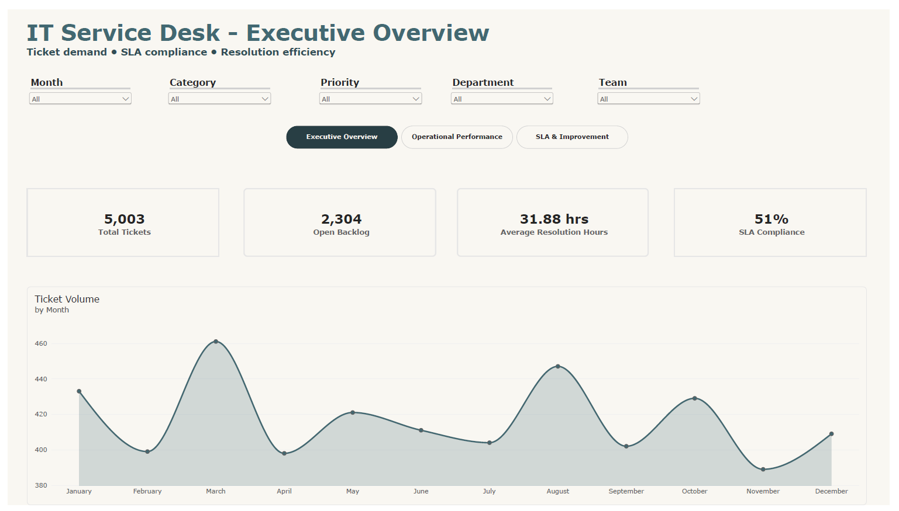
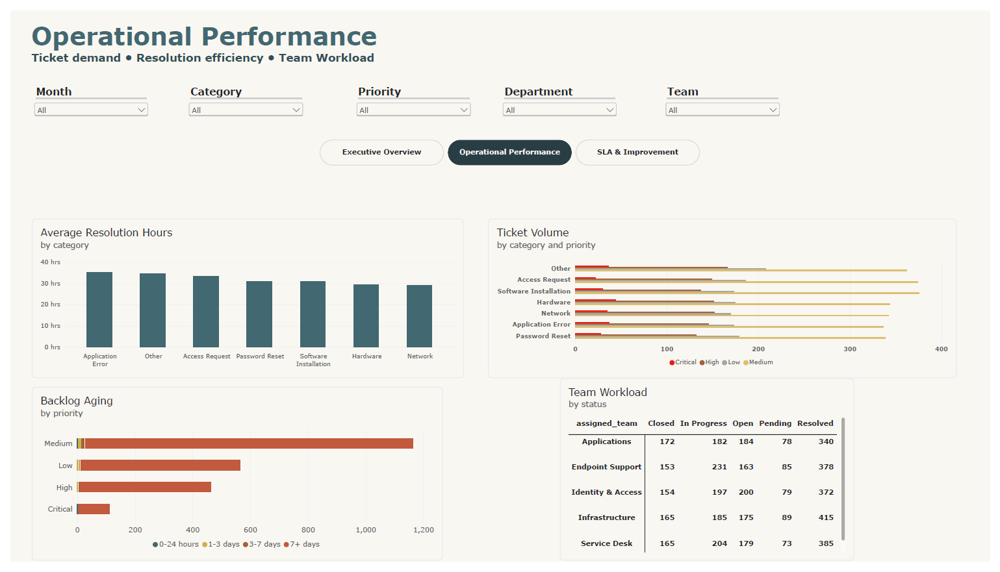
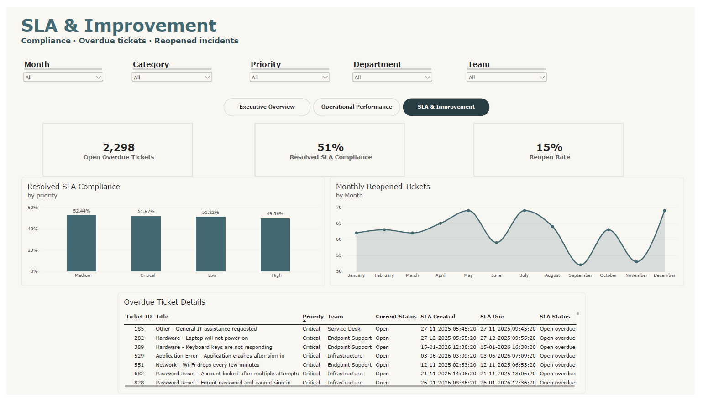

# IT Service Desk Transformation & SLA Analytics

**Portfolio project | Entry-Level IT Business Analyst | MySQL · SQL · Power BI · Python/Flask**

## Project Overview

IT support managers need a clear view of incoming tickets, unresolved work, resolution time, and whether resolved tickets meet their service-level agreement (SLA). Inconsistent ticket categorisation and unclear reporting rules can make it difficult to identify overdue work and operational bottlenecks.

This project prototypes a data-informed service desk workflow using synthetic ticket data. It combines business requirements and user stories, a MySQL database, SQL-based KPI analysis, a three-page Power BI report, a small Flask ticket-management application, and an advisory AI ticket-category classifier.

> **Data note:** The project uses synthetic data only. The figures are illustrative and do not represent the performance of a real organisation.

## Business Objectives

- Define consistent, understandable rules for ticket status, resolution time, backlog, and SLA reporting.
- Help managers distinguish resolved-ticket SLA compliance from currently open overdue tickets.
- Explore ticket demand and workload by month, category, priority, department, and assigned team.
- Identify aging and reopened-ticket patterns that may warrant operational investigation.
- Document requirements, user stories, acceptance criteria, and UAT scenarios.
- Test whether an AI model can suggest ticket categories while leaving the final decision to a human agent.

## Dataset Description

The repository includes `data/synthetic_tickets.csv`, a generated dataset containing **5,000 synthetic ticket records**. The data-generation script can also create and load a new sample into MySQL.

Key fields include:

| Field | Business meaning |
|---|---|
| `external_ticket_key` | Unique external-style ticket reference |
| `title`, `description` | Ticket summary and issue description |
| `category`, `priority` | Issue classification and urgency |
| `department`, `assigned_team` | Requesting department and responsible support team |
| `status` | Ticket state: Open, In Progress, Pending, Resolved, or Closed |
| `created_at`, `first_response_at`, `resolved_at` | Ticket lifecycle timestamps |
| `sla_due_at` | Target time by which the ticket should be resolved under the example SLA rule |
| `reopened_count`, `resolution_code` | Reopening and resolution information |

The dataset is simulated using predefined categories, priorities, short repeated descriptions, and randomly generated timestamps. It is useful for demonstrating a workflow, but it is not representative evidence of real ticket behaviour.

## Tools and Technologies

- **MySQL 8+:** Relational schema, ticket storage, SLA policies, and an analytical view.
- **SQL:** KPI calculations, monthly and category trends, resolution-time analysis, backlog aging, workload, reopen rate, and data-quality checks.
- **Power BI Desktop:** Three report pages for executive overview, operational performance, and SLA/improvement analysis.
- **Python:** Synthetic data generation, KPI helper functions, data checks, and model training.
- **Flask:** Local prototype for viewing, creating, and updating tickets and trying category suggestions.
- **scikit-learn (TF-IDF + Logistic Regression):** Advisory text-classification proof of concept.
- **pytest:** Unit tests for selected KPI and SLA helper functions.

## Methodology

1. **Frame the business problem:** Document the problem statement, scope, assumed stakeholders, business objectives, risks, and example SLA rules.
2. **Translate needs into requirements:** Define business and functional requirements, user stories, acceptance criteria, and requirement-to-test traceability.
3. **Model the data:** Create MySQL tables for tickets, ticket history, categories, priorities, departments, teams, and SLA policies, plus a view with response/resolution durations and SLA status.
4. **Generate and inspect data:** Create synthetic ticket records and run checks for missing fields and invalid timestamp ordering.
5. **Analyse operational KPIs:** Use SQL to examine ticket volume, resolution times, resolved-ticket SLA compliance, open overdue work, backlog aging, reopen rate, and workload by team and status.
6. **Communicate findings:** Build a three-page Power BI report with filters for month, category, priority, department, and team.
7. **Prototype workflow support:** Use a local Flask app to create and update tickets and display optional AI category suggestions for human review.
8. **Test and document limitations:** Include unit tests and UAT scenarios, record known defects, and identify where results need further validation.

## Key Analysis and Findings

The following figures are calculated from the checked-in `data/synthetic_tickets.csv` snapshot, not claimed as real business performance:

| Measure | Result from CSV snapshot | Definition |
|---|---:|---|
| Total tickets | 5,000 | All records in the CSV |
| Open backlog | 2,302 (46.0%) | Tickets whose status is not Resolved or Closed |
| Tickets with a resolution timestamp | 2,698 | Records with `resolved_at` populated |
| Average resolution time | 31.90 hours | Mean elapsed time from creation to resolution for resolved tickets |
| Resolved-ticket SLA compliance | 51.45% | Resolved tickets completed on or before `sla_due_at`, divided by resolved tickets with an SLA due time |
| Tickets reopened at least once | 750 (15.0%) | Records with `reopened_count` greater than zero |

### What these results suggest

- **Backlog needs segmentation:** A single backlog total does not show urgency. Prioritising by SLA due time, priority, and age can help teams decide what to investigate first.
- **SLA compliance needs a clear denominator:** Resolved-ticket compliance should be reported separately from open overdue tickets so the measures answer different operational questions.
- **Resolution time should be segmented:** Comparing resolution duration by category, priority, and assigned team can help identify areas for further investigation rather than assuming one overall average explains performance.
- **Reopened tickets merit review:** The synthetic data includes tickets reopened at least once. In a real service desk, repeat issues could be investigated by category and resolution code to check for incomplete fixes or recurring problems.

### Important validation caveat

The included Power BI PDF export displays **5,003 total tickets**, **2,304 open backlog**, **31.88 average resolution hours**, and **51% SLA compliance**. These differ from the 5,000-row CSV snapshot and its calculated results. The project documentation notes that tickets were added manually and that SQL-to-dashboard reconciliation is unfinished. Therefore, dashboard figures and CSV figures should **not** be presented as one reconciled result until the same data snapshot and KPI definitions are used across both.

The AI evaluation file reports 100% accuracy, but the training data contains only 14 distinct ticket descriptions. Repeated template text can cause train/test leakage-like overlap and makes the score unsuitable as evidence of real-world performance. The classifier is a prototype only and requires a more realistic, independently collected evaluation dataset.

## Business Recommendations

These are proposed actions to validate with real service desk stakeholders; they are not measured outcomes from this synthetic project.

1. **Create an SLA triage view:** Surface open tickets nearing or past their due time, grouped by priority and assigned team, so managers can review exceptions first.
2. **Agree on KPI definitions:** Confirm the SLA clock, eligible ticket population, treatment of paused tickets, and handling of reopened tickets with stakeholders before operational reporting is adopted.
3. **Investigate workload and resolution variation:** Review volume, average and median resolution time, backlog age, and reopen rate by category and team to identify where further process analysis is needed.
4. **Strengthen data quality controls:** Enforce allowed categories and priorities, validate required fields and timestamps, and make sure ticket creation reports success only when the database insert succeeds.
5. **Complete UAT and metric reconciliation:** Run the outstanding tests, fix or document defects, and compare SQL and Power BI using the same database snapshot and timestamp.
6. **Keep AI human-reviewed:** Do not auto-classify or route tickets based on this model. Test with varied, realistic ticket descriptions and report per-category precision and recall before considering a pilot.

## Business Impact

If validated with real users and production-quality data, this approach could help an IT support team:

- Improve visibility into backlog and SLA exceptions.
- Make operational reporting more consistent and auditable.
- Focus investigation on categories or teams with higher resolution times or reopening rates.
- Reduce manual reporting effort through reusable SQL queries and dashboard views.
- Evaluate workflow improvements against an agreed baseline.

These are potential benefits only. No real-world efficiency improvement or business outcome has been measured in this portfolio project. The documented 15% resolution-time reduction is an example target for a future pilot, not a result.

## Project Structure

```text
it_service_desk_mysql_project/
├── app/                     # Flask routes, database access, KPI helpers, classifier, templates and styles
├── data/
│   └── synthetic_tickets.csv # 5,000-row synthetic dataset
├── docs/
│   ├── 01_Business_Case_and_BRD.docx
│   ├── 02_Requirements_and_User_Stories.docx
│   ├── 03_Process_and_Data.docx
│   └── 04_Test_and_UAT.docx
├── Power Bi/
│   ├── IT_service_desk.pbix # Power BI report source
│   └── IT_service_desk.pdf  # Exported report preview
├── reports/
│   └── classifier_evaluation.txt
├── scripts/                 # Synthetic data generation, data checks, classifier training
├── sql/
│   ├── 01_schema.sql        # Schema, SLA policies, KPI view and local demo account
│   └── 02_analytics.sql     # SQL analysis and data-quality checks
├── tests/                   # KPI/SLA unit tests
├── requirements.txt
├── run.py
└── README.md
```

## How to Run the Project

### Prerequisites

- Python 3.11 or later
- MySQL Community Server 8.0 or later
- Power BI Desktop on Windows, if you want to inspect or refresh the report
- MySQL Connector/NET may be required for Power BI connectivity

### 1. Create a Python environment

```bash
python -m venv .venv
```

Activate it, then install dependencies:

```bash
# Windows PowerShell
.\.venv\Scripts\Activate.ps1

# macOS/Linux
source .venv/bin/activate

python -m pip install --upgrade pip
pip install -r requirements.txt
```

### 2. Configure MySQL

Start MySQL and run the schema script from the project root:

```bash
mysql -u root -p < sql/01_schema.sql
```

The script creates the `service_desk` database and required tables/view. Review the local demo account and credentials before use. Copy `.env.example` to `.env` and set local database credentials and a private Flask secret key. **Never commit `.env` or real credentials to GitHub.**

### 3. Generate and load synthetic data

```bash
python scripts/seed_data.py --count 5000 --seed 42
python scripts/check_data.py
```

**Warning:** The seed script deletes existing rows from the demo `ticket_history` and `support_tickets` tables before inserting the generated records. Use only a disposable local database; do not point it at real or production data.

### 4. Run SQL analytics

Run `sql/02_analytics.sql` in MySQL Workbench or another MySQL client. Review the query results and check that the KPI definitions match those used in Power BI.

### 5. Launch the local Flask prototype

```bash
python run.py
```

Open `http://127.0.0.1:5000` in your browser. The application is a local portfolio prototype and does not have production-grade authentication; do not expose it publicly.

### 6. Train and evaluate the category classifier

```bash
python scripts/train_classifier.py
```

The evaluation is saved to `reports/classifier_evaluation.txt`. Treat the current score as non-representative because the synthetic text is highly repetitive. Category suggestions are advisory and require human review.

### 7. Open the Power BI report

Open `Power Bi/IT_service_desk.pbix` in Power BI Desktop. To refresh it, connect to the local `service_desk` MySQL database and use the `vw_ticket_kpis` view. Reconcile the data and measures before presenting the dashboard figures as final results.

### 8. Run unit tests

```bash
pytest -q
```

The included tests cover selected Python KPI helper functions; they do not constitute full end-to-end, SQL, web application, or Power BI testing.

## Dashboard





## Known Gaps and Next Steps

The project documents the following issues and validation work still needed:

- Reconcile the 5,000-row CSV with the 5,003-ticket dashboard export using a single data snapshot.
- Complete SQL-to-Power BI metric reconciliation.
- Run the outstanding UAT scenarios for invalid field values and reopening tickets.
- Fix or verify application behaviour around invalid categories/priorities and reopening resolved tickets.
- Implement and test ticket-change history; the history table exists but is not fully populated by the current workflow.
- Improve the monthly chart so months from different years are distinguishable and the axis is appropriate.
- Evaluate the classifier on varied, realistic ticket text with a separate test dataset.
- Add dashboard screenshots and document the verified refresh steps.

## Skills Demonstrated

- Business problem framing and scope definition
- Stakeholder identification and interview-question planning
- Business requirements, functional requirements, user stories, and acceptance criteria
- Process and data documentation, business rules, and requirement traceability
- SQL querying, KPI definitions, SLA analysis, backlog analysis, and data-quality checks
- Power BI reporting and operational KPI communication
- UAT planning, unit testing, defect identification, and validation planning
- Translating analysis into practical, testable business recommendations
- Responsible use of an AI classification prototype with human oversight

---

## Author

**Vikash Verma** — aspiring Data / Business Analyst
- GitHub: [github.com/iamvikash28](https://github.com/iamvikash28)
- LinkedIn: [linkedin.com/in/iamvikash28](https://linkedin.com/in/iamvikash28)
- Email: vikashverma566@gmail.com

---

